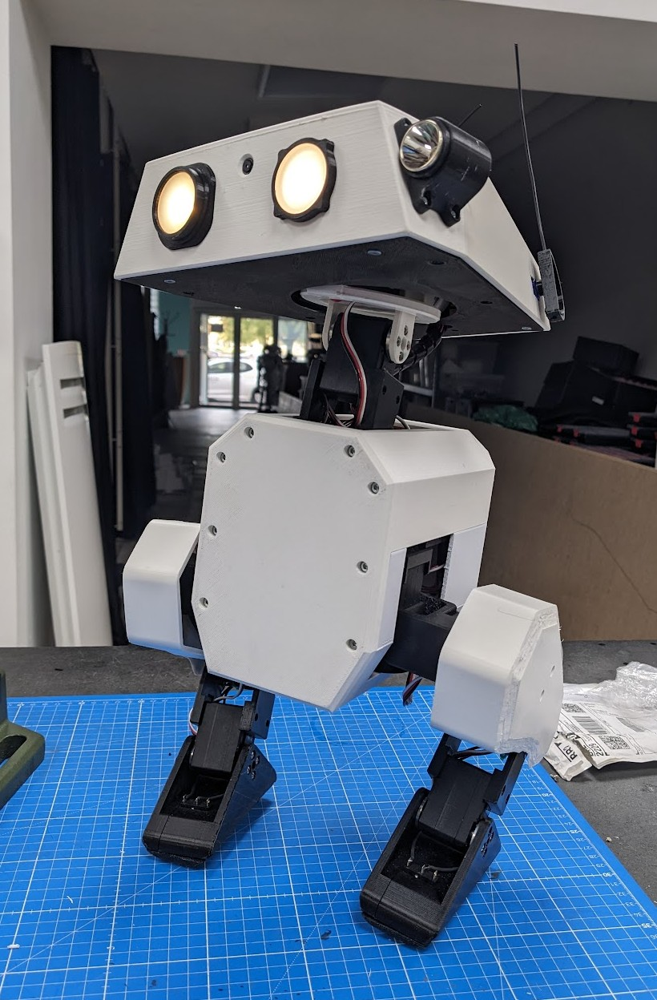

# Open Duck Mini v2 Bipedal Walking Robot (Refurbished)



A 42 cm two-legged walking robot in the style of a cartoon duck droid. Fourteen Feetech STS3215 bus servos, a Raspberry Pi Zero 2 W and a BNO055 IMU, with a reinforcement-learning walking policy running onboard. This is a refurbished remix of [Open Duck Mini](https://github.com/apirrone/Open_Duck_Mini) by Antoine Pirrone (apirrone) and the Open Duck Mini contributors.

## Install and build guide

This guide covers the core walking robot. Head lights, speaker and camera are optional.

### 1. Before you start

- Tools: soldering iron (with an insert tip), 2 mm and 2.5 mm hex drivers, small Phillips driver, wire strippers, multimeter.
- Set up the Raspberry Pi Zero 2 W with Raspberry Pi OS Lite and enable SSH.
- Configure every STS3215 servo (ID and zero position) one at a time on the bench before it goes into the robot. Label each servo with its ID.

### 2. Print the parts

PLA, 0.2 mm layers, 15% infill unless noted.

| Part | Qty | Notes |
|---|---|---|
| foot_top | 2 | |
| foot_side | 2 | |
| foot_bottom_pla | 2 | |
| foot_bottom_tpu | 2 | TPU, 40% infill |
| knee_to_ankle_left_sheet | 4 | |
| knee_to_ankle_right_sheet | 4 | |
| leg_spacer | 4 | |
| left_roll_to_pitch / right_roll_to_pitch | 1 each | mirrored, do not swap |
| roll_motor_bottom / roll_motor_top | 2 each | |
| trunk_bottom / trunk_top | 1 each | |
| neck_left_sheet / neck_right_sheet | 1 each | |
| head_pitch_to_yaw, head_yaw_to_roll, head_roll_mount | 1 each | |
| head, head_bot_sheet | 1 each | |
| left/right_antenna_holder, left/right_cache | 1 each | |
| body_front, body_middle_bottom, body_middle_top, body_back, battery_pack_lid | 1 each | |
| bulb, flash_light_module, flash_reflector_interface, left_eye, right_eye, speaker_interface, speaker_stand | 1 each | only for the optional head lights and speaker |

### 3. Trunk

1. Press the bearings into `trunk_bottom` and set the M3 heat-set inserts, including the four in the bottom for the body panels.
2. Join `trunk_bottom` and `trunk_top` with two M3x10 screws.
3. Mount the middle servo with the plastic screws supplied with the servos, then fit `roll_motor_bottom`.

### 4. Feet

1. Join `foot_bottom_tpu` and `foot_bottom_pla` with two M3x6 screws into inserts.
2. Set the inserts in `foot_top` and mount the ankle servo with its driven side toward `foot_top`.
3. Press-fit two foot switches per foot so they close when the sole touches the ground.

### 5. Shins, thighs and hips

1. Set two inserts on each side of every `leg_spacer`.
2. Route the ankle servo cable through the right-hand sheet, then close the shin with the left-hand sheet.
3. Build the thighs the same way. Mount the hip pitch servo in the orientation shown in the CAD so its zero matches the policy.
4. Fit `left_roll_to_pitch` / `right_roll_to_pitch`, then mount `roll_motor_top` on the hip yaw servo from below.
5. Attach each finished leg to the trunk.

### 6. Neck and head

1. Assemble the neck sheets around the two neck servos.
2. Add `head_pitch_to_yaw`, `head_yaw_to_roll` and `head_roll_mount`, then the head shell.
3. Fit the 9 g antenna servos in the antenna holders.

### 7. Electronics

1. Build the 2S pack: two 18650 cells in the holder, BMS, XT30 lead, power switch and USB-C charger board. Check polarity with a multimeter before connecting anything else.
2. Power the servo bus straight from the pack. Feed the Raspberry Pi through the 5 V UBEC.
3. Connect the Pi to the Waveshare adapter with the short USB cable, and the BNO055 to the Pi I2C pins.
4. Wire the foot switches to Pi GPIO inputs.
5. Daisy-chain the servo cables and protect them with braided sleeve where they cross joints.

### 8. Software and first walk

1. Install the Open Duck Mini runtime (https://github.com/apirrone/Open_Duck_Mini_Runtime) on the Pi and load a trained walking policy. Servo IDs and zero positions are described in the original `docs/configure_motors.md`.
2. With the robot on a stand, power up and check every joint moves in the expected direction at a low speed.
3. Calibrate the IMU, then let it stand and walk on a flat floor, ready to catch it.

### Safety

- Use threadlocker only on metal-to-metal servo screws.
- Li-ion packs can catch fire if shorted or over-discharged. Use the BMS, insulate every joint and charge under supervision.
- Fingers out of the legs while the servos are powered.

## Documentation download

This repository is the documentation and source download for the build.

- **Download ZIP:** use GitHub's **Code → Download ZIP** button, or clone:

  ```bash
  git clone https://github.com/ToolKnox/hawkridge-open-duck-mini-v2-bipedal-robot.git
  ```

- **Build guide:** this README, also as [`docs/build-guide.md`](docs/build-guide.md).
- **Print files (STL, 36 parts):** [`source/upstream/print/`](source/upstream/print/)
- **Original print, assembly and motor setup guides:** [`source/upstream/docs/`](source/upstream/docs/)
- **Wiring diagram:** [`source/upstream/docs/open_duck_mini_v2_wiring_diagram.png`](source/upstream/docs/open_duck_mini_v2_wiring_diagram.png)
- **Onboard runtime (separate project):** https://github.com/apirrone/Open_Duck_Mini_Runtime
- **Original upstream README:** [`source/upstream/README.md`](source/upstream/README.md)

## Repository contents

- `docs/`: the build guide.
- `download-documentation/`: how to download this package.
- `images/`: cover photo.
- `source/upstream/`: mirror of the upstream project at commit `b23317a485b3cec7d8417f352478778b3475173c`, with the print files, original docs, wiring diagrams, training experiments and example walking policies.

Not included in this repository: the community head mods under `print/mods/` and the simulation meshes under `mini_bdx/robots/`. They are not needed for the build.

## Credits and license

Remix of [Open Duck Mini](https://github.com/apirrone/Open_Duck_Mini) by Antoine Pirrone (apirrone) and the Open Duck Mini contributors, Apache License 2.0. Mirrored from commit [`b23317a`](https://github.com/apirrone/Open_Duck_Mini/tree/b23317a485b3cec7d8417f352478778b3475173c). The upstream license is kept at [`LICENSE`](LICENSE) and [`source/upstream/LICENSE`](source/upstream/LICENSE).

Changes by Hawkridge, updated for modern use: one core build path for the walking robot, a current-parts bill of materials with integer quantities and this rewritten print and build guide. Files under `source/upstream/` are unmodified.
